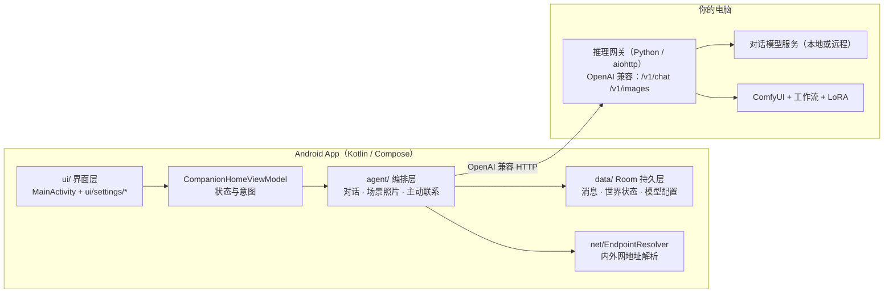

# 架构说明（Architecture）

> 目标：让人在 10 分钟内知道「数据从哪来、到哪去、代码在哪」，而不是翻 4000 行文件。

## 一、模块地图



## 二、三条主链路

| 链路 | 入口 | 过程 | 出口 |
|---|---|---|---|
| **聊天** | `ui/` 输入 | `CompanionHomeViewModel` → `ConversationTurnCoordinator` → 组装上下文（记忆 + 世界状态 + 最近对话）→ LLM | 消息入库（Room）→ 界面流式展示 |
| **场景照片** | 她主动发 / 用户要 | `ScenePromptCoordinator`（决定拍什么 → 生成提示词）→ 网关 `/v1/images/generations` → ComfyUI | 图片落盘 + 消息入库 |
| **主动联系** | `LiteProactiveCoordinator`（定时） | 读世界状态 → 判断该不该联系 → 生成消息/照片 | 后台调度，前台展示 |

## 三、目录与职责

| 路径 | 职责 | 规模 |
|---|---|---|
| `ui/MainActivity.kt` | 应用壳：导航、主题、底部栏 | ~1600 行 |
| `ui/settings/*.kt` | 各功能页与编辑器（14 个模块） | 每页 200~900 行 |
| `companion/ui/CompanionHomeViewModel.kt` | 界面状态、用户意图 | ~1600 行 |
| `companion/agent/` | 对话、场景、主动行为、世界推演等**编排** | 按文件职责划分 |
| `companion/agent/ScenePromptCoordinator.kt` | 场景提示词：决策 → 组装 → 校验 | ~427 行 |
| `companion/data/` | Room 实体、DAO、密钥加密 | — |
| `companion/net/EndpointResolver.kt` | 内外网地址解析（自动探测 + 缓存） | ~230 行 |

## 四、关键设计决策（详见 `docs/DECISIONS.md`）

1. **一个 Base URL 统一异构后端** —— 对话与出图都走 OpenAI 兼容协议，本地网关和各家 API 用同一条通道。
2. **零迁移的状态演进** —— 跨会话状态存 `world_states`（scope 隔离），加功能不加表。
3. **出图提示词 = 结构化约束** —— LLM 只负责"描述画面"，格式/长度/禁用词由规则与校验兜底。
4. **本地优先 + 可观测** —— 数据不出机器；请求耗时与失败原因记录在网关日志（`docs/` 内有说明）。

## 五、构建与验证

```bash
./gradlew :app:testDebugUnitTest      # 1089 个单元测试
./gradlew :app:assembleDebug          # 产出 debug APK
```

CI（GitHub Actions）在每次 push 时自动跑上面两条命令，见 `.github/workflows/ci.yml`。